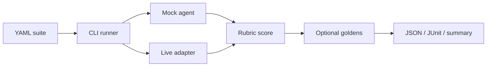

# Architecture

The harness loads a YAML or JSON suite, calls an agent adapter for each case, scores the output with a rubric, optionally compares against golden files, and writes reports.

## Pieces

- **Suite:** list of cases with `input` and `rubric`
- **Adapter:** `mock` (deterministic, no network) or `openai` (OpenAI-compatible API)
- **Rubric:** required/forbidden text, length bounds, JSON keys
- **Goldens:** snapshot files under a directory you choose
- **Reporters:** JSON always; JUnit and GitHub step summary on request

## Adding a case

1. Open or create a YAML file under `suites/`
2. Add an `id`, `input`, and `rubric`
3. Run `npm run eval -- --suite suites/your-file.yaml`
4. If you use goldens, run once with `--update-goldens --golden goldens/` then commit the files
